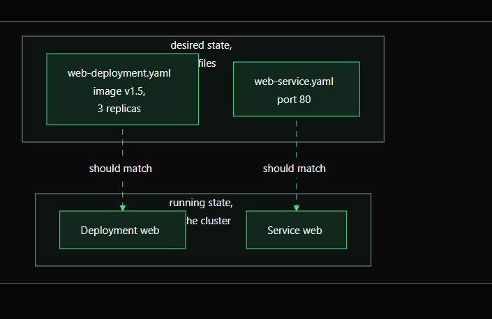
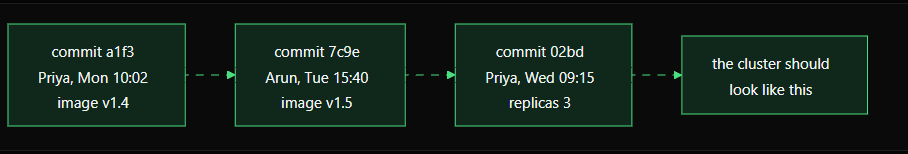
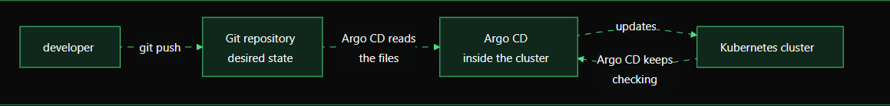

# GitOps Day 1 — Foundations and Argo CD

**Format:** scenario-driven, hands-on engineering lab  
**Level:** beginner to intermediate Kubernetes / SRE  
**Environment:** Kubernetes, `kubectl`, `git`, Minikube, Argo CD, and a Git remote (GitHub or equivalent)

## Mission

You are the SRE responsible for a small web service running in Kubernetes. Until now, engineers have changed live resources with `kubectl`. This has created uncertainty about who changed production, which image is running, and whether the cluster matches the reviewed configuration.

Your task is to introduce a GitOps workflow. Git will hold the desired state, and Argo CD will continuously compare that state with the Kubernetes cluster and synchronize changes.

## Day 1 outcomes

By the end of the labs, you must be able to:

- distinguish desired state from running state;
- explain Git as the source of truth and commits as an audit trail;
- describe the Git → Argo CD → Kubernetes reconciliation loop;
- install and access Argo CD in a test cluster;
- register a Git repository and deploy a web application;
- change the image or replica count through Git and verify the result;
- create configuration drift and observe how Argo CD reports it;
- explain the difference between detecting drift and automatically correcting it.

## Architecture and lesson diagrams

### 1. Desired state vs. running state



The YAML in Git describes what should exist. Kubernetes contains what exists now. GitOps continuously compares the two.

### 2. Git history as the change record



Each reviewed commit records a change to the desired state. The cluster's intended configuration can be traced back to Git history.

### 3. Reconciliation flow



A developer pushes a change. Argo CD reads the repository, compares it with the cluster, and synchronizes resources according to the application's sync policy.

## Core concepts

| Term | Meaning | Day-1 example |
|---|---|---|
| Desired state | What the team declares should exist | Deployment with image `nginx:1.25` and 2 replicas |
| Live/running state | What Kubernetes currently has | The actual Deployment and Pods |
| Source of truth | Authoritative place for declared configuration | Git repository |
| Reconciliation | Repeated comparison and convergence toward desired state | Argo CD compares Git and cluster |
| Sync | Applying the desired manifests to the cluster | Argo CD creates/updates Deployment and Service |
| Drift | Difference between declared and live configuration | Live replica count manually changed to 4 |
| Audit trail | Record of who changed what and when | Git commit history |

**Important distinction:** GitOps does not mean that Git itself deploys the application. A controller such as Argo CD runs in or has access to the cluster and performs reconciliation. A Git commit does not automatically change a cluster unless a deployment controller is configured to act on it.

## Prerequisites

Check that the tools are installed:

```bash
git --version
kubectl version --client
minikube version
helm version
```

Helm is not required for the plain-YAML application in this lesson, but it may be useful in later GitOps lessons.

Start a local cluster:

```bash
minikube start --cpus=4 --memory=8192
kubectl get nodes
kubectl cluster-info
```


## Operational guardrails

- Keep credentials out of Git. Use a secret-management approach in later lessons; do not commit passwords, tokens, or private keys.
- Use a test namespace and a disposable cluster.
- Review YAML changes before pushing them.
- Do not enable automated pruning or self-healing in a real environment without understanding the impact and agreeing on safeguards.
- The lab uses a public sample container image. For a real service, use your organization's approved image registry and versioning policy.

