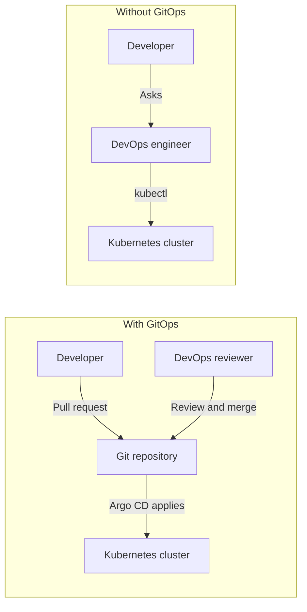
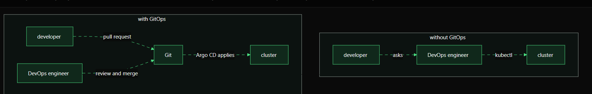
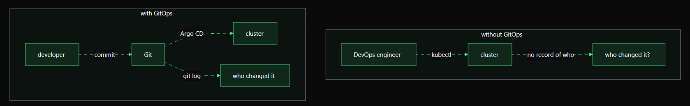
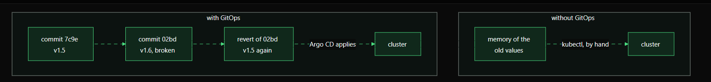
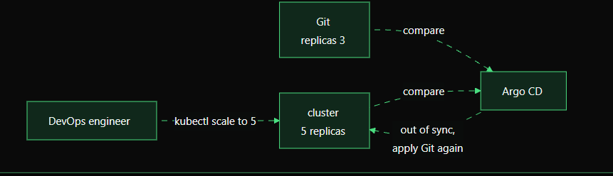

# GitOps Day 2 — Why Teams Use GitOps

> **Training focus:** Four everyday team scenarios, GitOps vs. traditional operations, and practical Argo CD exercises.
>
> **Environment:** Kubernetes (Minikube is suitable), Git, and Argo CD  
> **Estimated time:** 3–4 hours

---

## Learning objectives

By the end of this lesson, you should be able to:

- Compare traditional Kubernetes deployment with a GitOps workflow.
- Use pull requests to review desired-state changes.
- Trace configuration changes with Git history and blame.
- Roll back a bad change with `git revert`.
- Introduce and identify configuration drift.
- Explain Argo CD automated sync and self-healing.

## The big picture: GitOps vs. without GitOps

With GitOps, the change is proposed and reviewed in Git. Argo CD applies the approved desired state to the cluster. Without GitOps, a developer may need to ask an engineer with cluster access to make a direct change.



---

## Scenario 1 — A new version goes live

**Without GitOps:** A developer asks an engineer with cluster access to change the Deployment or run `kubectl`.

**With GitOps:** The developer changes YAML, opens a pull request, a reviewer approves and merges it, and Argo CD applies the desired state.



Example change:

```yaml
containers:
  - name: nginx
    image: nginx:1.26
```

Suggested Git commands:

```bash
git checkout -b update-nginx-version
git add .
git commit -m "Update nginx image to 1.26"
git push -u origin update-nginx-version
```

Open a pull request and merge it according to your team's review process.

**What to observe:** The change is reviewed and recorded in Git before it reaches the cluster.

## Scenario 2 — A manager asks: Who changed it?

**Without GitOps:** You may inspect Kubernetes `managedFields`, but it does not reliably identify the human engineer responsible for a change. You may need to ask around.

**With GitOps:** Git history shows the commit, author, timestamp, and change.



Useful commands:

```bash
git log --oneline
git log --pretty=fuller
git log --follow -- deployment.yaml
git show <commit-id>
git blame deployment.yaml
```

**SRE takeaway:** Git provides an auditable history of intended configuration changes. It complements—not replaces—cluster and platform audit logs.

## Scenario 3 — The app breaks after a change

Suppose a known-good commit deployed image `v1.5`, and a later commit changed it to a broken `v1.6`.

**With GitOps:** Revert the bad commit. The revert creates a new commit, and Argo CD can reconcile the cluster to the reverted desired state.



Revert the change:

```bash
git revert <commit-id>
git push
```

A revert does **not** erase the original commit; it adds a new commit that reverses its changes.

**What to verify:** Check the new Git commit, Argo CD application status, Deployment image, and pod health. A Git revert restores the declared configuration; application recovery still depends on the reverted version being valid and healthy.

## Scenario 4 — A DevOps engineer changes the cluster by hand

Suppose Git declares three replicas:

```yaml
spec:
  replicas: 3
```

An engineer manually scales the Deployment to five:

```bash
kubectl scale deployment web --replicas=5
kubectl get deployment web
```

The live cluster now differs from the desired state in Git. This is **configuration drift**.



Argo CD compares the live object with the desired state and reports the application as `OutOfSync`. With automated sync and self-healing configured, it can reconcile the live object back to the Git-declared state.

Example Application sync policy fragment:

```yaml
spec:
  syncPolicy:
    automated:
      selfHeal: true
```

> **Important:** Self-healing requires the relevant automated sync configuration. Without it, Argo CD can show the difference but may wait for a sync action. Pruning is a separate setting and is not enabled by this example.

---

## Hands-on labs

Use a **lab cluster, not production**. Work through the labs in order and record what you observe in Argo CD and Kubernetes.

### Lab 1 — Traditional vs. GitOps

1. Create a Deployment imperatively:
   ```bash
   kubectl create deployment web --image=nginx:1.25
   kubectl scale deployment web --replicas=2
   kubectl get deployment web
   ```
2. Deploy the same workload through a Git repository and Argo CD.
3. Compare auditability, review, and repeatability.

### Lab 2 — Pull request workflow

1. Change the image in the manifest.
2. Create a feature branch and commit the change.
3. Push the branch and open a pull request.
4. Review and merge it.
5. Observe Argo CD's application status and deployed image.

### Lab 3 — Trace a change

1. Run `git log --pretty=fuller`.
2. Run `git blame deployment.yaml`.
3. Run `git show <commit-id>`.
4. Record the author, timestamp, changed line, and commit message.

### Lab 4 — Roll back a bad image

1. In a non-production lab, change the image to a deliberately invalid tag.
2. Commit and push.
3. Inspect the pod and its events:
   ```bash
   kubectl get pods
   kubectl describe pod <pod-name>
   ```
4. Revert the bad commit and push.
5. Verify that Argo CD reconciles to the previous desired configuration.

### Lab 5 — Create configuration drift

1. Ensure Git declares three replicas.
2. Manually scale the Deployment to five:
   ```bash
   kubectl scale deployment web --replicas=5
   ```
3. Inspect the live Deployment and Argo CD status.
4. Explain why the live state differs from Git.

### Lab 6 — Verify self-healing

1. Configure automated sync with `selfHeal: true` on the Argo CD Application.
2. Repeat the manual scale to five.
3. Observe Argo CD detect and reconcile the drift.
4. Verify that the replica count returns to three.

---

## Completion checklist

- [ ] Explain the traditional deployment workflow.
- [ ] Explain the pull-request GitOps workflow.
- [ ] Find the author and content of a change in Git.
- [ ] Revert a bad commit.
- [ ] Create and identify configuration drift.
- [ ] Explain when Argo CD self-healing acts.

