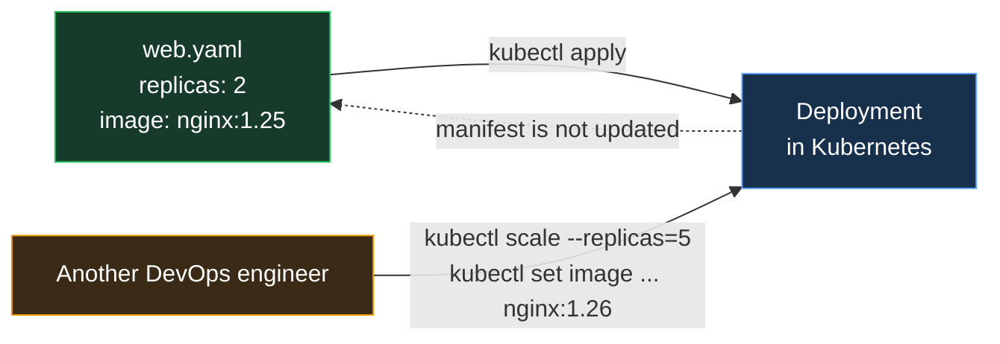
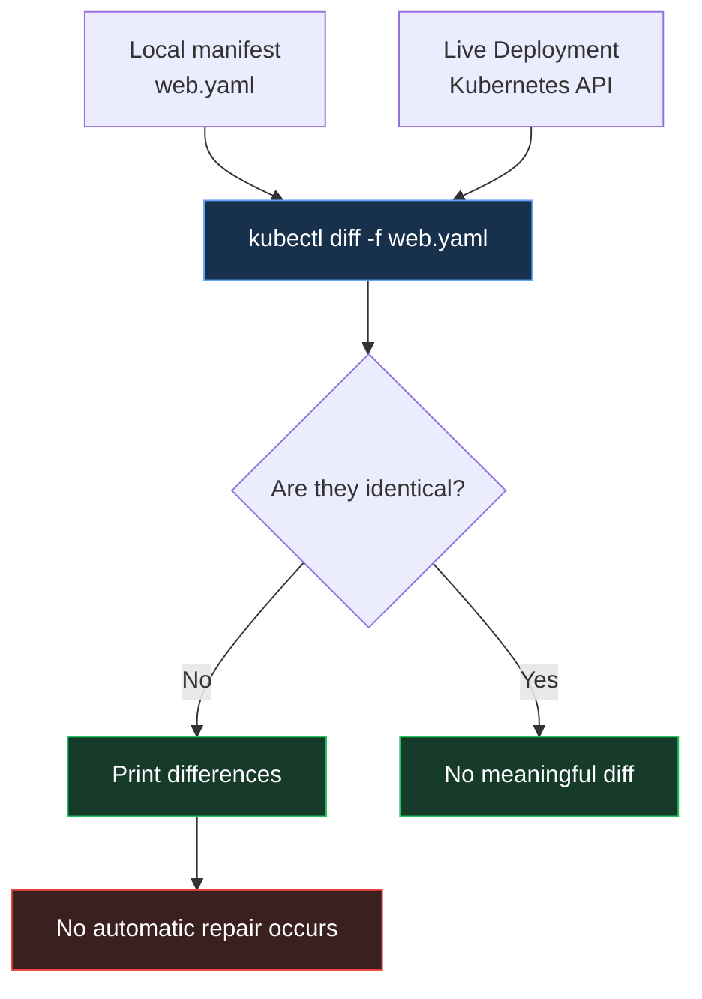
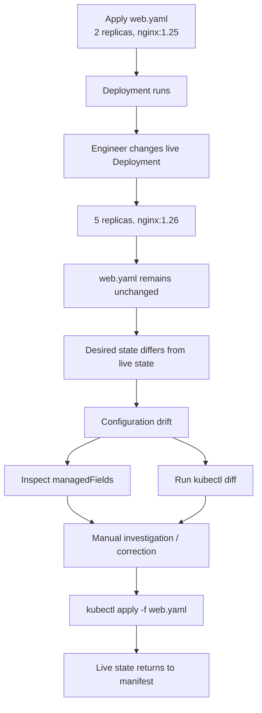

# GitOps Day 3 — Changes Without GitOps

> **Training focus:** Kubernetes configuration drift using an nginx Deployment  
> **Level:** Beginner → practical SRE  
> **Estimated time:** 2–3 hours  
> **Environment:** Minikube or another disposable Kubernetes cluster, `kubectl`, Git

## Learning objectives

By the end of this lesson, you should be able to:

1. Deploy nginx from a YAML manifest.
2. Change replicas with `kubectl scale`.
3. Change an image with `kubectl set image`.
4. Explain why imperative changes do not update the YAML file.
5. Inspect live state and `managedFields`.
6. Compare a manifest with the live object using `kubectl diff`.
7. Explain configuration drift and its operational risks.

---

## 1. The problem: a manual change creates drift

Initially, the manifest describes two replicas and an older image. Another engineer changes the live Deployment directly. The cluster changes, but the file does not.



### Desired file vs. live cluster

| Field | `web.yaml` (desired) | Kubernetes (live) |
|---|---:|---:|
| Replicas | 2 | 5 |
| Image | `nginx:1.25` | `nginx:1.26` |

The two representations no longer agree. This mismatch is **configuration drift**.

---

## 2. Lab environment and safety

Use a local or disposable cluster. Do not run these exercises against production.

```bash
kubectl config current-context
kubectl get nodes
```

If using Minikube:

```bash
minikube start
kubectl config use-context minikube
```

Create a working directory:

```bash
mkdir gitops-day3
cd gitops-day3
```

---

## 3. Lab 01 — Create the original desired state

Create `web.yaml`:

```yaml
apiVersion: apps/v1
kind: Deployment
metadata:
  name: web
  labels:
    app: web
spec:
  replicas: 2
  selector:
    matchLabels:
      app: web
  template:
    metadata:
      labels:
        app: web
    spec:
      containers:
        - name: nginx
          image: nginx:1.25
          ports:
            - containerPort: 80
```

Apply and verify:

```bash
kubectl apply -f web.yaml
kubectl get deployment web
kubectl get pods -l app=web
kubectl get deployment web -o wide
```

**Expected:** two replicas, using `nginx:1.25`. Wait until both pods are ready.

---

## 4. Lab 02 — Another engineer changes the live cluster

Scale the Deployment:

```bash
kubectl scale deployment web --replicas=5
```

Change the image:

```bash
kubectl set image deployment/web nginx=nginx:1.26
```

Check the live state:

```bash
kubectl get deployment web
kubectl get deployment web \
  -o jsonpath='{.spec.replicas}{"\n"}{.spec.template.spec.containers[0].image}{"\n"}'
```

Inspect the original file:

```bash
grep -nE 'replicas:|image:' web.yaml
```

**Expected observation:**

- The live Deployment now declares five replicas and `nginx:1.26`.
- `web.yaml` still declares two replicas and `nginx:1.25`.
- These imperative commands changed the live object, not the local file.

---

## 5. Lab 03 — Who changed it?

Inspect the Deployment, including managed fields:

```bash
kubectl get deployment web -o yaml --show-managed-fields
```

Look for:

```yaml
metadata:
  managedFields:
```

You may see managers such as `kubectl-scale` or `kubectl-set`. These entries help identify the client or manager that modified fields and record operation/time information.

**Important:** `managedFields` is not a reliable human audit log. It generally identifies a field manager/tool, not the individual engineer who ran the command. Exact entries vary by Kubernetes version and client.

For a compact view:

```bash
kubectl get deployment web -o jsonpath='{range .metadata.managedFields[*]}{.manager}{"\t"}{.operation}{"\t"}{.time}{"\n"}{end}'
```

Discuss:

- Can you identify the exact human from this output?
- Can you see which manager last managed particular fields?
- Why is this not a substitute for a reviewed Git commit and an audit trail?

---

## 6. Lab 04 — Nobody is told: compare the file and cluster

Run:

```bash
kubectl diff -f web.yaml
```

`kubectl diff` compares the configuration that would be applied from the file with the live object. It prints differences; it does **not** apply the changes.

You should find differences corresponding to the replica count and image. Other metadata or defaulted fields can also appear.

### Understand the diff



**Key point:** `kubectl diff` only helps when someone remembers to run it. It does not continuously monitor the cluster.

---

## 7. Lab 05 — Nothing fixes it automatically

At this point:

- The file says two replicas and `nginx:1.25`.
- The live Deployment says five replicas and `nginx:1.26`.
- No GitOps controller is watching and reconciling this manifest.
- The cluster remains in its manually changed state until someone takes action.

To restore the original file's configuration manually:

```bash
kubectl apply -f web.yaml
```

Verify:

```bash
kubectl get deployment web
kubectl get pods -l app=web
kubectl get deployment web \
  -o jsonpath='{.spec.replicas}{"\n"}{.spec.template.spec.containers[0].image}{"\n"}'
```

**Expected:** the Deployment should converge back to two replicas and `nginx:1.25`.

This final apply is a manual correction. In a later lesson, GitOps reconciliation will show how a controller can continuously compare and correct drift.

---

## 8. The three problems caused by changes without GitOps

| Problem | What happens | Operational impact |
|---|---|---|
| Who changed it? | Kubernetes manager metadata may identify a tool, not the human | Weak accountability |
| Nobody is told | No continuous comparison or alert is provided by this workflow | Drift can go unnoticed |
| Nothing fixes it | No controller reconciles the object to the file | Manual recovery is required |

## 9. End-to-end lesson flow



---

## 10. SRE troubleshooting questions

1. Why did `web.yaml` remain unchanged after `kubectl scale`?
2. What is the difference between desired state and live state?
3. What information does `managedFields` provide?
4. Does `managedFields` reliably tell you which human ran a command?
5. What does `kubectl diff -f web.yaml` do?
6. Does `kubectl diff` repair configuration drift?
7. What happens if nobody notices the drift?
8. How would you prevent unreviewed manual changes in a production GitOps workflow?

## 11. Day-3 completion checklist

- [ ] Confirmed the active Kubernetes context.
- [ ] Created and applied `web.yaml`.
- [ ] Verified two replicas and `nginx:1.25`.
- [ ] Scaled the live Deployment to five replicas.
- [ ] Changed the live image to `nginx:1.26`.
- [ ] Confirmed that the YAML file did not change.
- [ ] Inspected `managedFields`.
- [ ] Compared file and live state using `kubectl diff`.
- [ ] Explained why no automatic repair occurred.
- [ ] Restored the Deployment with `kubectl apply -f web.yaml`.

## 12. Cleanup

```bash
kubectl delete -f web.yaml
```

If you created a dedicated Minikube cluster only for this lab and no longer need it:

```bash
minikube delete
```

---

## Key takeaway

> **Drift happens when the running system no longer matches the file that describes it.**

Without GitOps, Kubernetes does not continuously compare this local YAML file with the live cluster or automatically restore it. Detecting and correcting the mismatch is left to people and their operational processes.

**Next lesson:** Create configuration drift on a real Deployment, then introduce Argo CD reconciliation to see how GitOps addresses the problem.


---
