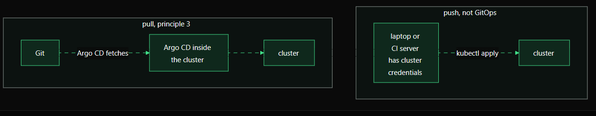
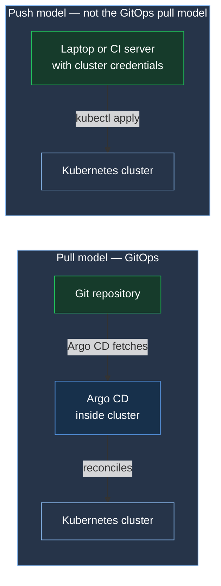
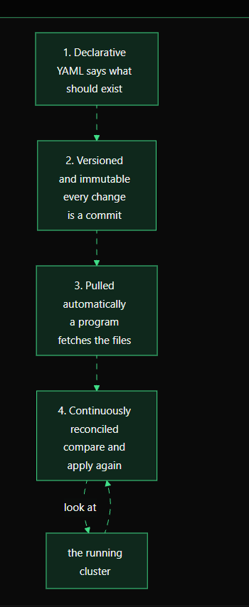
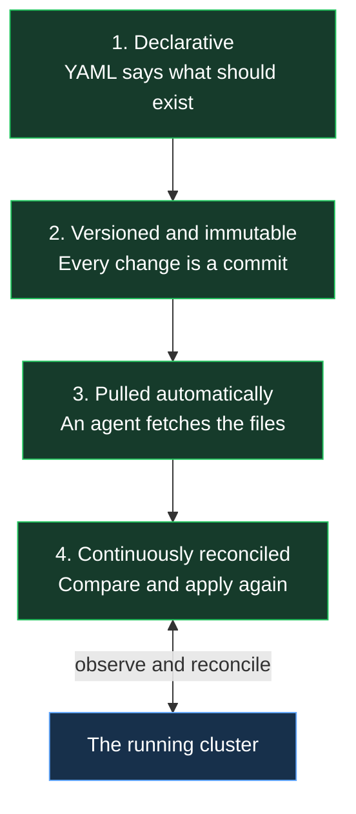

# GitOps Day 4 — The Four OpenGitOps Principles
## Learning objectives

By the end of this lesson, you should be able to:

1. Name the four OpenGitOps principles.
2. Explain each principle in plain language.
3. Distinguish declarative configuration from imperative commands.
4. Explain why Git history matters for desired state.
5. Explain the difference between a pull-based GitOps model and pushing changes into a cluster.
6. Describe continuous reconciliation and how it addresses drift.
7. Explain how Argo CD implements the pull and reconciliation principles.

---

## 1. What are the OpenGitOps principles?

Many teams use the word *GitOps* to describe different workflows. OpenGitOps defines four principles that give the term a shared meaning.

The lesson identifies OpenGitOps as part of the Cloud Native Computing Foundation (CNCF), the organisation that also looks after Kubernetes. The principles are published at [opengitops.dev](https://opengitops.dev) as version 1.0.0.

The four principles are:

1. **Declarative**
2. **Versioned and immutable**
3. **Pulled automatically**
4. **Continuously reconciled**

The first two describe how desired state is represented and stored. The last two describe how software agents fetch and apply that desired state.

---

## 2. Principle 1 — Declarative

> “A system managed by GitOps must have its desired state expressed declaratively.”

### What does it mean?

You describe **what the system should look like**, rather than writing down the sequence of steps needed to make it look that way.

For example, a Kubernetes Deployment manifest can declare:

```yaml
spec:
  replicas: 2
```

This says the desired number of replicas is two.

Compare that with an imperative command:

```bash
kubectl scale deployment web --replicas=5
```

The command tells Kubernetes to perform an action. It does not, by itself, update the YAML file that describes the desired state.

### Remember

| Declarative | Imperative |
|---|---|
| Describes the desired result | Describes an action to perform |
| Example: `replicas: 2` in YAML | Example: `kubectl scale ...` |
| Can be compared with live state | A command changes live state |

**Key takeaway:** YAML describes what should exist. It is the declaration of desired state.

---

## 3. Principle 2 — Versioned and immutable

> “Desired state is stored in a way that enforces immutability, versioning and retains a complete version history.”

### What does it mean?

Every change to the desired-state files is saved as a new version. Git records commits, authorship information, timestamps, and the changes made.

This gives the team a history of how the desired configuration evolved.

For example:

```text
commit a1f3  — image: nginx:1.25
commit 7c9e  — image: nginx:1.26
commit 02bd  — replicas: 3
```

You can inspect that history with:

```bash
git log --oneline
```

To inspect a particular change:

```bash
git show <commit-id>
```

The lesson describes old versions as versions that cannot be edited or lost. In practice, Git history provides versioned change records; teams should protect important branches and repositories so that history is retained.

### Remember

- Each desired-state change is represented by a commit.
- The history helps answer who changed what and when.
- Previous versions provide a basis for reviewing or reverting changes.

**Key takeaway:** Git stores the version history of the desired state.

---

## 4. Principle 3 — Pulled automatically

> “Software agents automatically pull the desired state declarations from the source.”

### What does it mean?

A software agent inside the environment fetches the desired-state files from Git. A person on a laptop or a CI server does not need to push Kubernetes changes directly into the cluster.

In this lesson, Argo CD is the software agent running inside the Kubernetes cluster.

### Pull model vs. push model



The distinction:



### Why does the pull model matter?

- The agent fetches the desired state from its source.
- A laptop or CI server does not need to push manifests directly to the cluster in this model.
- Cluster credentials do not need to be distributed to every developer workstation or CI job for deployment.

**Key takeaway:** Argo CD pulls the desired state from Git; the cluster-side agent performs the deployment.

---

## 5. Principle 4 — Continuously reconciled

> “Software agents continuously observe actual system state and attempt to apply the desired state.”

### What does it mean?

The agent does not stop after fetching the files once. It continues comparing:

- **Desired state:** what the files in Git say should exist.
- **Actual state:** what is currently running in the Kubernetes cluster.

When the two differ, the agent identifies the difference and attempts to apply the desired state again.

This is reconciliation.

### The four principles working together





### Example: configuration drift

Suppose Git declares:

```yaml
spec:
  replicas: 3
```

But someone manually changes the Deployment:

```bash
kubectl scale deployment web --replicas=5
```

The desired state and actual state now differ:

| Source | Replicas |
|---|---:|
| Git desired state | 3 |
| Kubernetes actual state | 5 |

Argo CD continuously compares the two states. It can report the application as OutOfSync and, when automated synchronization with self-healing is configured, apply the Git-defined value again.

**Key takeaway:** Continuous reconciliation detects differences between desired and actual state and works to bring them back into agreement.

---

## 6. How the four principles fit together

| Principle | Main question | What it provides |
|---|---|---|
| Declarative | What should exist? | Desired state expressed as configuration |
| Versioned and immutable | How are changes recorded? | Version history and traceability |
| Pulled automatically | How does the agent get the desired state? | Agent fetches declarations from the source |
| Continuously reconciled | How does the system stay aligned? | Continuous observation and corrective action |

### What Argo CD contributes

The lesson's central distinction is:

- Your YAML files in Git cover **Principles 1 and 2**: declarative desired state and versioned history.
- Argo CD covers **Principles 3 and 4**: automatic pulling and continuous reconciliation.

Together, these form the GitOps workflow described in this lesson.

---

## 7. Quick knowledge recap

Before moving to the next lesson, make sure you can explain these points without reading the definitions:

- **Declarative:** describe what should exist, not a sequence of commands.
- **Versioned and immutable:** desired-state changes are recorded as versions in Git.
- **Pulled automatically:** an agent fetches the desired state from its source.
- **Continuously reconciled:** an agent observes actual state and attempts to apply desired state.

**One-line summary:** Git stores the desired state and its history; Argo CD pulls it and continuously works to keep Kubernetes aligned with it.

---

## Source

- [OpenGitOps — GitOps Principles](https://opengitops.dev/)

## Next lesson

The next three quick checks test how far these four rules reach.
