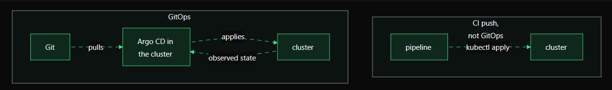
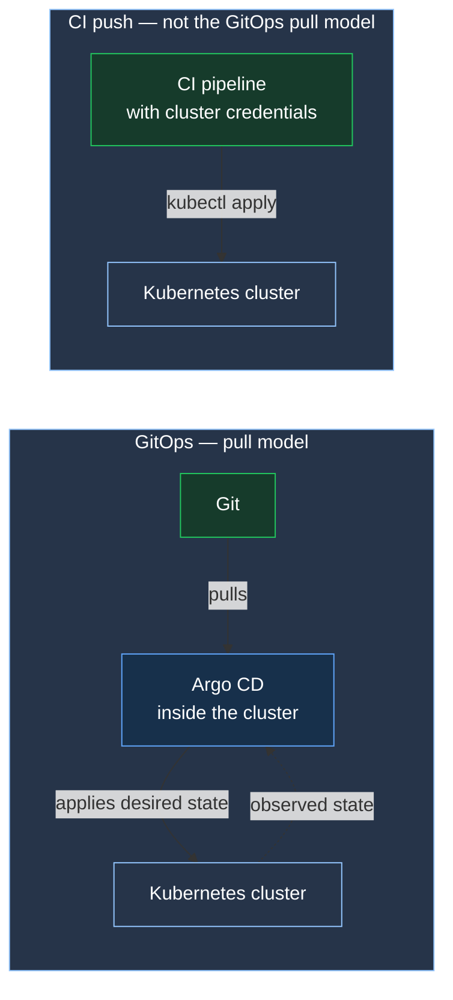

# GitOps Day 5 — What GitOps Is Not
## Learning objectives

By the end of this lesson, you should be able to:

1. Explain why GitOps is not limited to Kubernetes.
2. Explain why GitOps is not defined by Git alone.
3. Distinguish a CI pipeline that runs `kubectl apply` from a pull-based GitOps workflow.
4. Explain why Argo CD and Flux are tools, while GitOps is a set of principles.
5. Recognise common examples of workflows that look like GitOps but do not follow all four principles.

---

## 1. Why this lesson matters

The previous lesson introduced the four OpenGitOps principles:

1. Declarative
2. Versioned and immutable
3. Pulled automatically
4. Continuously reconciled

Teams sometimes use the word *GitOps* for workflows that follow only part of this model. This lesson clears up four common misunderstandings.

---

## 2. Misunderstanding 1 — GitOps is only for Kubernetes

The four principles do not mention Kubernetes.

Any system that can be described in files and watched by a program can use a GitOps approach.

Examples mentioned in this lesson include:

- Cloud accounts
- DNS records
- Network switch settings
- Kubernetes resources

Kubernetes is where GitOps started, because its objects are already commonly described in YAML and it has programs that compare and correct the running state.

### Remember

GitOps is an operating model for managing desired state. Kubernetes is a common place to apply it, but it is not the only possible target.

---

## 3. Misunderstanding 2 — GitOps only works with Git

Principle 2 asks for desired-state storage that keeps versions and preserves history.

Git provides version history, but the lesson also points out that other storage systems can keep versioned artifacts. It gives a container registry that stores tagged files as an example, and notes that Flux and Argo CD can both read from one.

The name *GitOps* was chosen before the rules were written down.

### Remember

The important idea in this principle is versioned, retained desired state — not simply the presence of a Git command.

---

## 4. Misunderstanding 3 — A CI job that runs `kubectl apply` is GitOps

Some teams store YAML in Git and configure a pipeline to apply it whenever a change is merged.

That is close to GitOps, but the lesson distinguishes it from the pull-based model.

### CI push workflow

- A pipeline runs outside the cluster.
- It uses cluster credentials.
- It pushes changes into Kubernetes using `kubectl apply`.
- Nothing in this workflow necessarily keeps watching the cluster after the pipeline finishes.
- If someone changes the cluster manually, the drift can remain until another pipeline run.

### Pull-based GitOps workflow

- A program such as Argo CD runs inside the cluster.
- It pulls desired-state files from Git.
- It applies the desired state.
- It observes the running cluster and keeps checking for differences.

### Diagram — Pull model vs. CI push

### Side-by-side comparison

| CI push workflow | Pull-based GitOps workflow |
|---|---|
| Pipeline runs outside the cluster | Agent runs inside the cluster |
| Pipeline uses cluster credentials | Agent fetches desired state from its source |
| Pipeline pushes with `kubectl apply` | Agent pulls and applies desired state |
| No continuous reconciliation is implied by the pipeline alone | Agent continuously observes and reconciles |
| Manual drift can remain until another pipeline run | Drift can be detected and corrected by the agent, depending on its configuration |

**Key takeaway:** Keeping YAML in Git is not enough. The pull and continuous-reconciliation principles matter too.

---

## 5. Misunderstanding 4 — GitOps is a tool

Argo CD and Flux are tools. GitOps is the set of four principles.

A team can install Argo CD and still fail to practise GitOps fully. For example, everyone might continue making direct `kubectl` changes, and self-healing might never be enabled.

The tool makes it easier to follow the principles, but installing the tool does not automatically mean the team follows them.

### Remember

| Term | Meaning |
|---|---|
| GitOps | The principles and operating model |
| Argo CD | A tool that can implement GitOps for Kubernetes |
| Flux | Another tool that can implement GitOps for Kubernetes |

**Key takeaway:** A tool does not guarantee a GitOps practice. The team's workflow and configuration must follow the principles.

---

## 6. The four misunderstandings at a glance

| Common claim | What the lesson teaches |
|---|---|
| GitOps is only for Kubernetes | It can manage other systems that can be described declaratively and observed by software |
| GitOps only works with Git | The key is versioned, retained desired state |
| A CI job running `kubectl apply` is GitOps | A push pipeline alone does not provide the pull and continuous-reconciliation model |
| GitOps is a tool | Argo CD and Flux are tools; GitOps is the principles |

---

## 7. Knowledge recap

Before moving on, make sure you can explain:

- Why GitOps can apply beyond Kubernetes.
- Why versioned desired-state storage is the important idea behind Principle 2.
- Why a pipeline pushing `kubectl apply` is different from an in-cluster agent pulling desired state.
- Why installing Argo CD does not automatically mean a team is practising GitOps.

### One-line summary

**GitOps is not a Kubernetes-only practice, not merely Git storage, not a CI push pipeline, and not a tool — it is an approach built around four principles.**

---

## Next lesson

In the next topic you meet Argo CD, the program that performs this job, and install it on a real cluster.
